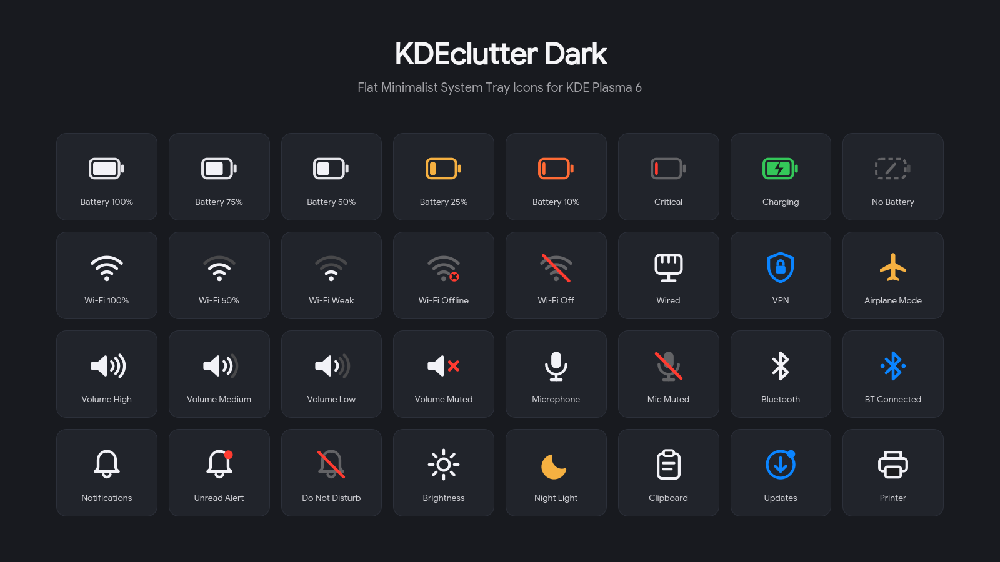
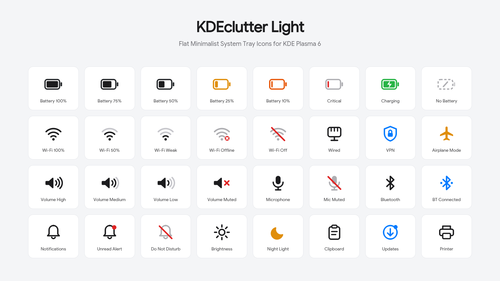

# KDEclutter

A minimalist, flat system tray icon pack for **KDE Plasma 6**, available in both **Dark** and **Light** variants.

KDEclutter replaces the default system tray status icons with clean, iOS/Android-inspired SVGs while inheriting Breeze for everything else—including full `FollowsColorScheme=true` support so Dolphin folder icons keep your wallpaper accent colors.

---

## Previews

### KDEclutter Dark


### KDEclutter Light


---

## What's Included

Both `KDEclutter-Dark` and `KDEclutter-Light` include standard and `-symbolic` SVGs for:

- **Battery & Power:** 0%–100% discharging, charging (green with lightning bolt), low/amber/critical states, fully charged & plugged in, and missing battery
- **Audio & Mic:** Volume (high, medium, low, muted) and microphone (active, muted)
- **Network:** Wi-Fi signal levels, disconnected/off/acquiring, Ethernet, VPN shield, and Airplane mode
- **Bluetooth:** Active, connected (blue accent), and disabled
- **Notifications:** Default bell, unread badge, and Do Not Disturb
- **Display & Lighting:** Brightness and Night Light
- **Utilities & Devices:** Clipboard (Klipper), System Updates, USB/Removable Devices, Plasma Vaults, KDE Connect, Keyboard, and Printer

---

## Installation

### Quick Install (Recommended)

```bash
unzip KDEclutter.zip
cd KDEclutter
bash install.sh
```

Then activate it in KDE:

1. Open **System Settings → Colors & Themes → Icons**.
2. Select **KDEclutter-Dark** (for dark panels) or **KDEclutter-Light** (for light panels) and click **Apply**.
3. If the tray still shows cached icons, restart Plasma Shell:
   ```bash
   systemctl --user restart plasma-plasmashell
   ```

### Manual Install

```bash
mkdir -p ~/.local/share/icons
cp -r icon-themes/KDEclutter-Dark icon-themes/KDEclutter-Light ~/.local/share/icons/
rm -f ~/.cache/icon-cache.kcache ~/.cache/plasma_theme_*.kcache
```

Then select **KDEclutter-Dark** or **KDEclutter-Light** under **System Settings → Colors & Themes → Icons**.

---

## Uninstall

```bash
bash uninstall.sh
```

Or remove them manually:

```bash
rm -rf ~/.local/share/icons/KDEclutter-Dark ~/.local/share/icons/KDEclutter-Light
rm -f ~/.cache/icon-cache.kcache
systemctl --user restart plasma-plasmashell
```
